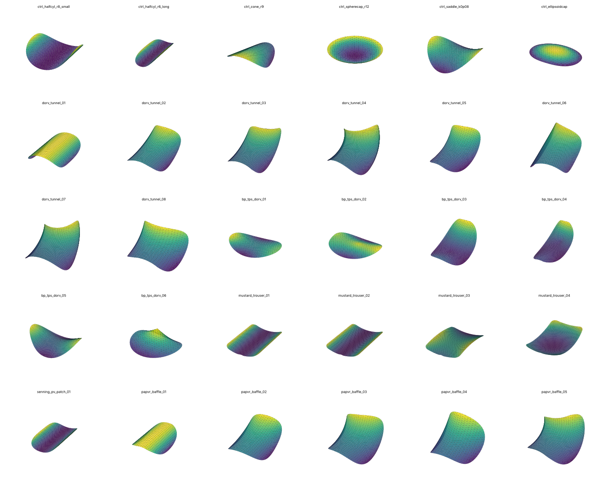
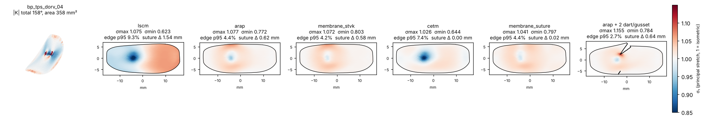
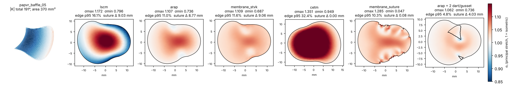
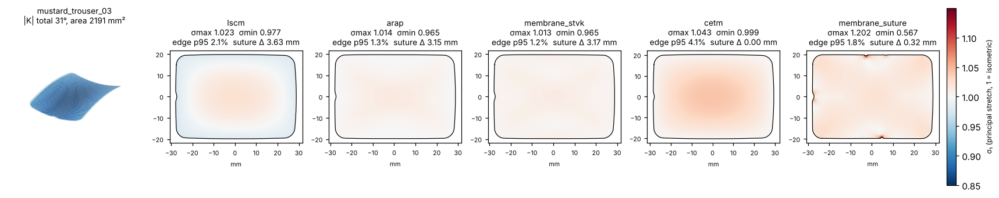
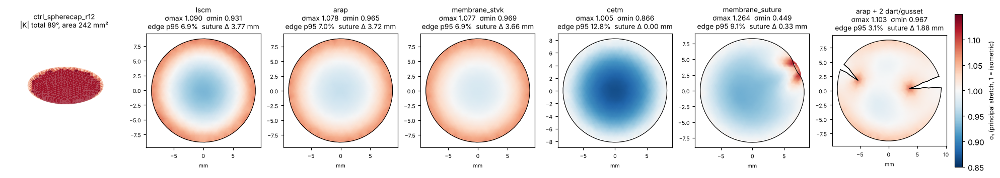
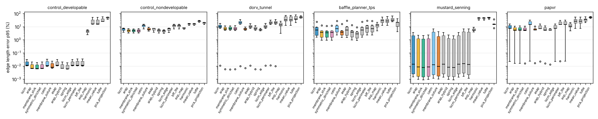
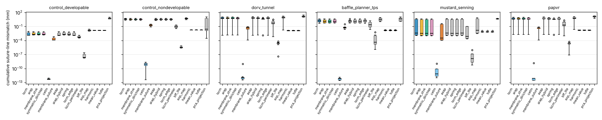
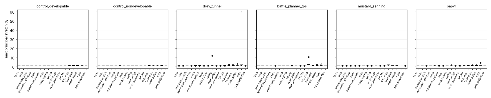
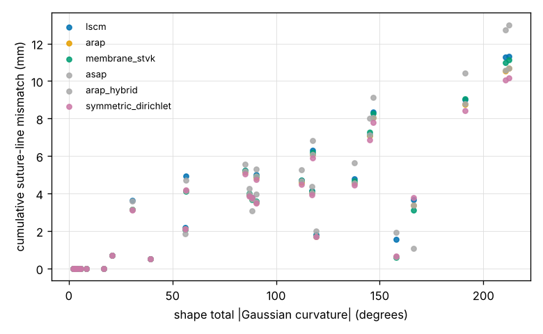
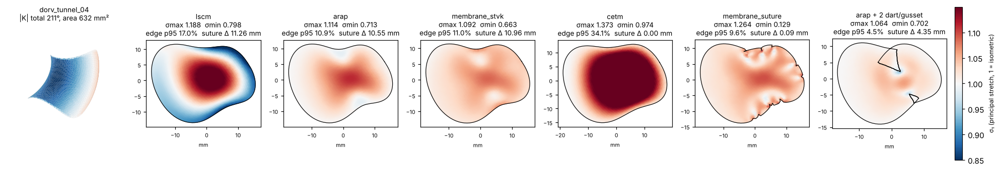

# slicerheart_patch_flattening

Flattening of 3D surgical patches and baffles (DORV intracardiac baffles, Mustard/Senning
atrial baffles, PAPVR baffles) into 2D templates that can be printed or laser cut, with
distortion and uncertainty metrics that say whether a template is fit for purpose.

Status: exploratory, standalone Python library (no Slicer dependency) with pure mathematical
(geometric) methods plus one CPU membrane model as the reference for the NVIDIA Warp / AD
stage (`physics_ml/`, separate track). Patch pressurisation is out of scope for the geometric
methods. `slicer_api.py` matches the Baffle Planner's contract (open `vtkPolyData` in,
flattened `vtkPolyData` out); the matching Baffle Planner change (method selector + stretch
colouring) is a separate SlicerHeart pull request. Benchmark tables are in `results/`, key
figures in `docs/figures/`; the 30-shape library and all templates are regenerated with the
two commands below.

## Default and recommendation (after two benchmark passes)

**ARAP is the default** (`flatten(mesh)` and `flatten_recommended(mesh)`): isometric local/global
flattening (Liu et al. 2008). It had the lowest length error among fold-free methods (edge p95
5.6 % vs 9.1 % for the LSCM the Baffle Planner uses now), ran in 0.1 s per patch and never
folded; symmetric Dirichlet and the StVK membrane give the same template to within 0.3 %.
`flatten_recommended` adds the metrics, and when the cumulative suture-line mismatch exceeds
1 mm it also proposes darts/gussets and returns the darted ARAP template, which halves that
mismatch on curved baffles. "Suture-exact" variants (`cetm`, `lscm_perimeter`) are offered as
options because their cost (interior stretch or rim buckling) has to be shown, not hidden.

```python
from slicerheart_patch_flattening import flatten_recommended
r = flatten_recommended(mesh)      # ARAP template, metrics, darts if needed
print(r.summary())
```

## Install

```bash
pip install -e .            # numpy scipy vtk matplotlib pandas shapely pygeodesic
pip install -e ".[ref,dev]" # + libigl (reference cross-checks) and pytest
python -m pytest tests
```

ITK is not required: `itk.ParameterizationQuadEdgeMeshFilter` is not exposed in the Python
wrapping, so the solvers are scipy sparse linear algebra and L-BFGS on numpy arrays. VTK is
used for mesh I/O, thin-plate splines (same `vtkThinPlateSplineTransform` as the Baffle
Planner), normals, subdivision and the Dijkstra fallback geodesic.

## Quick start

```python
from slicerheart_patch_flattening.library import build_library, write_library, load_library
from slicerheart_patch_flattening.algorithms import flatten
from slicerheart_patch_flattening.metrics import distortion_metrics
from slicerheart_patch_flattening import export

shapes = build_library()                     # 30 synthetic patches, mm
write_library("output/synthetic_library", shapes)

m = shapes[9]                                # a curved DORV tunnel baffle
res = flatten(m, "arap")                     # or "lscm" (current Baffle Planner), "membrane_stvk", ...
M = distortion_metrics(m, res.uv)            # dict of stretch / suture-line / size metrics
outline = export.template_outline(m, res.uv)
export.write_svg("template.svg", outline, m.name, suture_offset_mm=1.0)   # also write_dxf, write_pdf
```

Full benchmark (metrics CSVs, per-shape figures, SVG/DXF/PDF templates, darting; ~5 min on 2 cores):

```bash
python scripts/build_library.py output/synthetic_library
python -m slicerheart_patch_flattening.evaluate --library output/synthetic_library --out output/eval
```

## Tests, CI and the benchmark report

* `python -m pytest tests` runs 31 tests (solver correctness on analytic controls, libigl
  cross-checks, darting, Baffle Planner API round-trip, Warp membrane vs numpy, adjoint gradient
  check, export formats, dataset generator, report generation). GitHub Actions runs them on every
  pull request and push to `main` (`.github/workflows/tests.yml`, Python 3.10 and 3.12) and adds a
  quick 6-shape benchmark report as a workflow artifact.
* `python scripts/run_benchmark.py --out output/benchmark` rebuilds the library, runs every
  method and writes `report.md` / `report.pdf` with the same "Results of the benchmark" tables as
  below (plus per-family tables, uncertainty, darting and the figures). `--quick` is the CI smoke
  run. The `benchmark` workflow runs the full benchmark on demand and on every published release,
  and attaches `benchmark_report_<tag>.pdf`, the Markdown and a zip of the CSVs and figures to the
  release.

## Layout

```
slicerheart_patch_flattening/
  mesh.py            TriMesh (numpy V/F), boundary loop, angle defects, geodesics, VTK I/O
  library/           synthetic shape generators (generators.py) and the 30-shape library (build.py)
  algorithms/
    common.py        local frames, Jacobians, singular values, Laplacians, pins, scaling
    methods.py       pca_projection, tutte, harmonic, mean_value, lscm, lscm_edge, asap, arap,
                     arap_hybrid, spring, membrane_stvk  (+ METHODS registry, flatten())
    methods_extra.py symmetric_dirichlet, membrane_suture, bff_lite, cetm, exp_map, lscm_perimeter
  developabilize.py  nearest developable baffle with the suture line fixed (PyTorch L-BFGS)
  pipeline.py        flatten_recommended(): ARAP + metrics + darts (the default pipeline)
  physics_ml/        separate track: Warp membrane/shell, pressurised forward model, adjoint
                     inverse (template from loaded target), synthetic dataset (see its README)
  metrics.py         per-triangle stretch, edge/suture-line errors, width/length vs geodesic
  uncertainty.py     method spread (Procrustes) and mesh-refinement sensitivity
  darts.py           curvature concentration -> dart/gusset proposal -> mesh cut -> re-flatten
  export.py          SVG / DXF / PDF templates at 1:1 mm, suture-bite offset
  slicer_api.py      flatten_polydata(): the Baffle Planner-shaped interface (no Slicer dependency)
  clinical.py        loader for real cases placed in clinical_baffles/
  viz.py, evaluate.py, report.py (benchmark tables -> Markdown + PDF)
scripts/             build_library.py, run_benchmark.py
.github/workflows/   tests.yml (PR / push), benchmark.yml (on demand and on release)
clinical_baffles/    placeholder for real baffles (see its README)
tests/               pytest (controls, libigl cross-check, darting, API)
results/             benchmark CSVs from the committed run (results_long, summary_by_family, uncertainty, darts)
docs/figures/        library gallery, example per-shape figures, summary plots
REFERENCES.md        bibliography, every entry verified against OpenAlex
```

## Methods

| name | minimises | boundary | reference |
|---|---|---|---|
| `pca_projection` | nothing (orthographic projection) | free | baseline |
| `tutte`, `harmonic`, `mean_value` | Dirichlet energy, uniform / cotangent / mean-value weights | pinned to a circle (perimeter preserved) | Tutte 1963; Eck 1995; Floater 2003 |
| `lscm`, `lscm_edge` | conformal (Cauchy-Riemann) energy, 2 pins, then area- or edge-length rescale | free | Levy 2002. `lscm` = current Baffle Planner (ConformalTextureMapping CLI + sqrt(area) rescale) |
| `asap`, `arap`, `arap_hybrid` | local/global: closest similarity / rotation per triangle, cotangent Poisson solve | free | Liu 2008 |
| `spring` | mass-spring edge-length energy, L-BFGS from ARAP | free | physical analogue, no shear stiffness |
| `membrane_stvk` | St. Venant-Kirchhoff plane-stress membrane energy, L-BFGS from ARAP | free | CPU reference for the Warp FEM stage (same problem class as FEFlatten in Kizilski 2025) |
| `symmetric_dirichlet` | isometric energy with fold barrier, L-BFGS from ARAP | free | Smith & Schaefer 2015 |
| `membrane_suture` | StVK membrane + stiff springs on boundary edges | free, suture line held | physical "sutured to a fixed boundary" |
| `cetm`, `bff_lite` | discrete conformal with boundary scale factor 0, exact flat layout / harmonic extension | free, suture line held | Springborn 2008; Sawhney & Crane 2017 |
| `lscm_perimeter` | LSCM rescaled to the suture-line length | free | one-line variant of the Baffle Planner rescale |
| `exp_map` | geodesic polar coordinates (exact radial distances) | free | Schmidt 2006; not recommended for templates |

All methods: `FlatResult(uv, method, time_s, iterations, converged, info)` with `uv` in mm on
the input connectivity. `lscm` and `arap` were cross-checked against libigl: identical LSCM
solutions (1e-10 mm) and identical ARAP energies (6 digits).

## Metrics (`metrics.distortion_metrics`)

* per-triangle principal stretches sigma_1 >= sigma_2 of the 3D->2D Jacobian: area ratio,
  conformal ratio, Sander L2 / Linf stretch, isometric error, angle error (area-weighted mean,
  p95, max), flipped triangles
* edge-length errors (all edges, boundary edges) in % and the **cumulative suture-line
  mismatch** (range of the running 2D-vs-3D arclength difference around the boundary, mm):
  the number a surgeon matching marks along the suture line would experience
* template **length and width** vs the exact on-surface geodesic between the same boundary
  vertices (pygeodesic, MMP), checked against the 0.1 mm / 0.5 % tolerance of Kizilski et al.
* shape developability: integrated |Gaussian curvature| (degrees) from angle defects

`uncertainty.py` adds: boundary disagreement between methods after rigid alignment
(method uncertainty) and the outline change under one mesh subdivision (discretisation).

## Synthetic library (30 shapes, `library/build.py`)

| family | n | construction | developable |
|---|---|---|---|
| control_developable | 3 | half-cylinders, cone | yes (zero-distortion controls) |
| control_nondevelopable | 3 | spherical cap, saddle, ellipsoid cap | no (known K) |
| dorv_tunnel | 8 | partial tube swept along a bent, tapering, twisting centerline (LV->Ao pathway) | 1 of 8 |
| baffle_planner_tps | 6 | flat disk TPS-warped to a 3D boundary curve + 0-3 surface points, as the Baffle Planner builds it | no |
| mustard_senning | 5 | trouser-shaped atrial baffles on cylinder / sphere / saddle sheets, Senning PV patch | 3 of 5 |
| papvr | 5 | ovoid half-tunnels | 1 of 5 |

Sizes 20-55 mm, areas 190-2200 mm2, edge length ~0.8 mm (400-3800 vertices).

## Results of the first benchmark (synthetic library, all 11 methods)

Median over the 19 non-developable clinical-type shapes (dorv_tunnel, baffle_planner_tps, papvr):

| method | max stretch | min stretch | edge err p95 (%) | suture mismatch (mm) | angle err p95 (deg) | area err (%) | median time (s) |
|---|---|---|---|---|---|---|---|
| pca_projection | 1.00 | 0.08 | 47.6 | 11.0 | 67.0 | -31.8 | <0.01 |
| harmonic (circle) | 1.40 | 0.71 | 29.9 | 0.01 | 15.8 | +20.6 | 0.01 |
| lscm (Baffle Planner) | 1.089 | 0.895 | 9.1 | 4.2 | 0.9 | 0.0 | 0.03 |
| asap | 1.079 | 0.891 | 8.8 | 4.4 | 0.9 | -1.5 | 0.33 |
| arap | 1.059 | 0.868 | 5.6 | 4.0 | 3.4 | -0.2 | 0.08 |
| arap_hybrid (lam=1) | 1.061 | 0.881 | 5.5 | 4.0 | 3.1 | -0.2 | 0.10 |
| spring | 1.064 | 0.797 | 5.3 | 3.6 | 5.5 | -0.2 | 0.11 (folds on 5 shapes) |
| membrane_stvk | 1.047 | 0.862 | 5.7 | 4.1 | 4.4 | -0.4 | 0.17 |

Developable shapes (11): every free-boundary method reaches max edge error < 0.1 % and passes
the 0.1 mm / 0.5 % size tolerance; projection and circle-boundary maps fail by construction.

What this says so far:

1. **The choice of energy matters less than the shape.** On curved tunnels LSCM, ARAP and the
   membrane model disagree on the outline by 0.05-0.7 mm (max, after rigid alignment), while the
   intrinsic non-developability forces 4-11 mm of cumulative suture-line mismatch on the worst
   DORV tunnels whatever the method. Mesh refinement changes outlines by < 0.01 mm.
2. **ARAP (or the membrane model) halves the length error of LSCM** (edge p95 5.6 % vs 9.1 %)
   at the cost of a few degrees of angle error, which is irrelevant for a cut template. The
   area-rescaled LSCM used today spreads its error as a compression ring around the rim.
3. **Darting is the lever for strongly curved baffles.** The dart proposal (apex at the peak of
   the integrated curvature, cut to the nearest boundary point, opening angle = enclosed
   curvature) cut the suture-line mismatch by 50-70 % on every tunnel (e.g. dorv_tunnel_04:
   10.6 -> 4.4 mm with two gussets of -31 and -26 deg) with no fold-overs. Most tunnel
   baffles are saddle-like (negative K), so they need gussets (added material), not darts.
4. The 0.5 % / 0.1 mm tolerance of Kizilski et al. is only reachable for developable
   patches; for the rest the template must either accept the reported mismatch, be darted,
   or be designed with the fabric's stretch in mind (the pressurised / material stage).

### Figures

The 30-shape synthetic library, coloured by Gaussian curvature (saddle vs dome):



Per-shape figures: 3D shape, then LSCM, ARAP, membrane, CETM and suture-held membrane templates
coloured by principal stretch sigma_1 (blue compression, red tension), and the ARAP template
after the recommended darts/gussets (opened wedges):






Summary across the library, one box per method and family (log scale where the spread is large):






A full run writes one figure per shape to `output/eval/figures/`.

## Wider exploration of traditional methods (second pass)

Six more methods were added in `algorithms/methods_extra.py` and the benchmark re-run (17 methods x 30
shapes, `results/` and `docs/figures/` are from this run). Median over the 19 non-developable clinical
shapes:

| method | family | max stretch | min stretch | edge err p95 | boundary edge err max | suture mismatch | area err | shapes with folds |
|---|---|---|---|---|---|---|---|---|
| lscm (Baffle Planner) | conformal, area-scaled | 1.09 | 0.89 | 9.1 % | 8.6 % | 4.2 mm | 0 % | 0 |
| lscm_perimeter | conformal, perimeter-scaled | 1.16 | 0.96 | 14.9 % | 3.8 % | 0.4 mm | +14 % | 0 |
| asap | conformal | 1.08 | 0.89 | 8.8 % | 8.4 % | 4.4 mm | -1.6 % | 0 |
| arap | isometric | 1.06 | 0.87 | 5.6 % | 11.6 % | 4.0 mm | -0.2 % | 0 |
| arap_hybrid | isometric/conformal blend | 1.06 | 0.88 | 5.5 % | 10.0 % | 4.0 mm | -0.2 % | 0 |
| symmetric_dirichlet | isometric + fold barrier | 1.06 | 0.88 | 5.4 % | 11.1 % | 3.9 mm | +0.1 % | 0 |
| membrane_stvk | isometric (membrane) | 1.05 | 0.86 | 5.7 % | 12.1 % | 4.1 mm | -0.4 % | 0 |
| spring | edge springs | 1.06 | 0.80 | 5.3 % | 11.1 % | 3.6 mm | -0.2 % | 7 |
| membrane_suture | membrane, suture line held | 1.19 | 0.13 | 5.8 % | 0.2 % | 0.05 mm | 0 % | 13 |
| bff_lite | conformal, suture line held | 1.16 | 0.98 | 15.0 % | 0.0 % | 0.00 mm | +15 % | 0 |
| cetm | conformal, suture line held | 1.16 | 0.98 | 15.0 % | 0.0 % | 0.00 mm | +15 % | 0 |
| exp_map | geodesic polar | 1.65 | 0.47 | 13.8 % | 40.8 % | 6.8 mm | -5 % | 1 |
| harmonic (circle) | fixed boundary | 1.40 | 0.70 | 29.9 % | 0.0 % | 0.01 mm | +21 % | 0 |
| pca_projection | projection | 1.00 | 0.08 | 47.6 % | 57 % | 11.0 mm | -32 % | 8 |

What the second pass adds:

1. **The isometric family is one method.** ARAP, the ARAP/ASAP hybrid, symmetric Dirichlet and the
   StVK membrane agree to within 0.3 % on every metric; ARAP is the fastest and never folds, symmetric
   Dirichlet has a built-in fold barrier for meshes where ARAP might. There is nothing to gain from
   SLIM-type solvers at these mesh sizes (0.1 s per patch).
2. **Holding the suture line exactly is possible but has a price that must be shown.** CETM / BFF-lite
   (Springborn 2008; Sawhney & Crane 2017) give a template whose every boundary edge has exactly its 3D
   length with a conformal interior; on curved tunnels that means 15 % interior stretch and +15 % area.
   The suture-constrained membrane reaches the same boundary fit and instead *buckles* at the rim (13 of
   19 shapes fold) which is the physical "tissue bunching" a surgeon sees. The perimeter-scaled LSCM is
   the cheap middle ground (boundary error 3.8 % vs 8.6 %, suture mismatch 0.4 mm vs 4.2 mm) at +14 % area;
   it is a one-line change to the Baffle Planner's current rescale and worth exposing as an option.
3. **CETM and darts combine naturally**: on the darted mesh the cut edges are also held exactly, and CETM
   stays fold-free. With the current heuristic dart angles the interior still carries ~19 % error on the
   worst tunnels; solving for the cone angles (Soliman, Slepcev & Crane 2018) is the next step there.
4. **The exponential map is not a template method**; radial lengths are exact (it passes the Kizilski
   length/width check on 68 % of shapes, which says more about that check than about the method) while
   the rim is up to 40 % off.
5. **Developabilizing the baffle** (`developabilize.py`, PyTorch L-BFGS on the angle defects with the suture
   line fixed): for the Baffle-Planner-style baffles, moving the surface by at most 1.35 mm (RMS 0.2 mm)
   makes the baffle flattenable (|K| 158 -> 9 deg, ARAP edge error 4.4 -> 0.6 %, suture mismatch 0.6 ->
   0.3 mm on bp_tps_dorv_04). Swept tunnel baffles cannot be rescued this way (210 -> 124 deg at 0.9 mm);
   their boundary curve itself is incompatible with a developable surface. For a planner this is a
   useful mode: nudge the surgeon's baffle toward the nearest shape a flat patch can actually make.

Recommendation after both passes: ARAP as the default template (symmetric Dirichlet as the robust
fallback), `lscm_perimeter` or CETM offered as "suture-exact" variants with the interior stretch map shown,
darting when the suture mismatch exceeds a threshold, and developabilization offered at design time.



## Baffle Planner compatibility

`slicer_api.flatten_polydata(polydata, method, fixed_points_world)` takes the thin baffle
surface (`surfacePolyDataNormalsThin` output) and the two "fixed points", and returns a
`vtkPolyData` with the same cells, z = 0, in mm, with `stretch_s1`, `stretch_s2`, `area_ratio`
point arrays for colouring the flattened model and the fixed-point vertex ids in field data.
With `method="lscm"` it reproduces `flattenOutputBaffleModel` (LSCM pins + sqrt(area)
rescale) without the CLI round-trip; other methods only use the fixed points to orient the
template. Only the patch surface is touched; heart model, markups and printing stay in
the module.

## Roadmap

* clinical cases into `clinical_baffles/` and the same benchmark on them
* boundary-first flattening (Sawhney & Crane 2017) for direct control of suture-line lengths
* dart placement as an optimisation (where to cut, how many) rather than the current heuristic
* NVIDIA Warp membrane / shell with pressure, material anisotropy and contact, with AD for the
  inverse (unloaded template from a loaded target), using `membrane_stvk` as the CPU check
