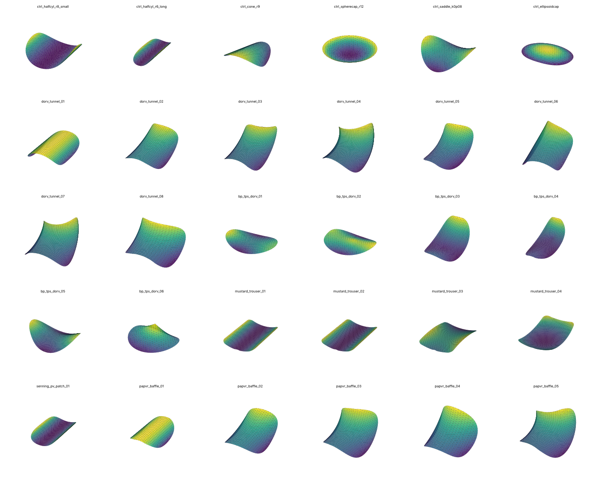
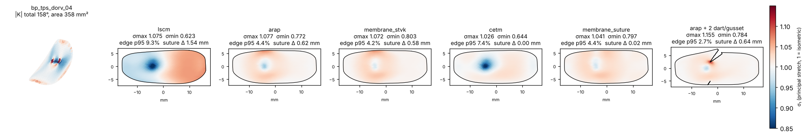
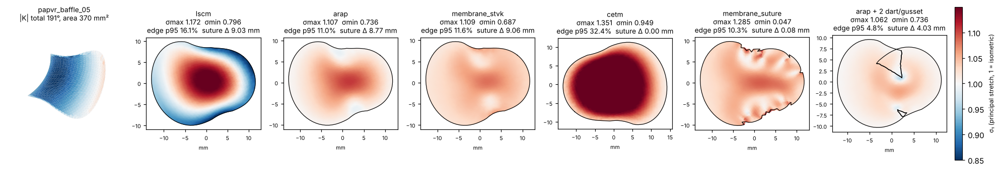
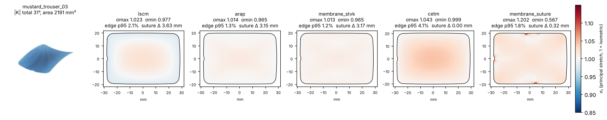
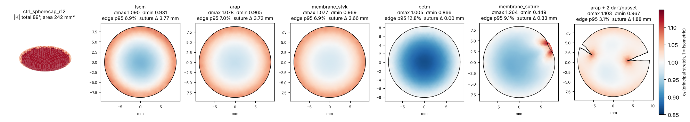
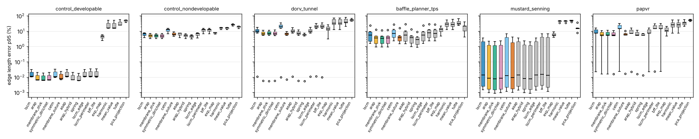
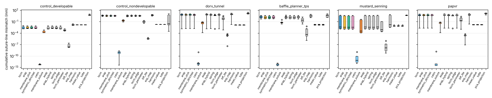
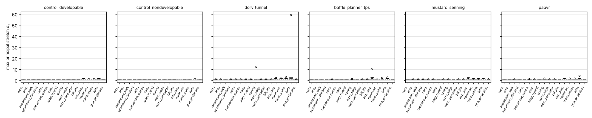
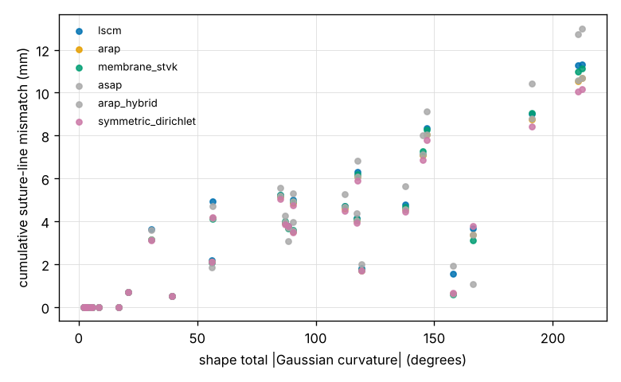

# Report 1: geometric flattening methods, first benchmark pass (11 methods x 30 shapes)

All figures referenced below are in `../docs/figures/`. Note: the CSVs in `../results/` and the figures are from the
second, 17-method pass (Report 2); the first-pass numbers below are a subset of the same shapes and methods.

## Methods compared

| name | minimises | boundary | reference |
|---|---|---|---|
| `pca_projection` | nothing (orthographic projection) | free | baseline |
| `tutte`, `harmonic`, `mean_value` | Dirichlet energy, uniform / cotangent / mean-value weights | pinned to a circle (perimeter preserved) | Tutte 1963; Eck 1995; Floater 2003 |
| `lscm`, `lscm_edge` | conformal (Cauchy-Riemann) energy, 2 pins, then area- or edge-length rescale | free | Levy 2002. `lscm` = current Baffle Planner (ConformalTextureMapping CLI + sqrt(area) rescale) |
| `asap`, `arap`, `arap_hybrid` | local/global: closest similarity / rotation per triangle, cotangent Poisson solve | free | Liu 2008 |
| `spring` | mass-spring edge-length energy, L-BFGS from ARAP | free | physical analogue, no shear stiffness |
| `membrane_stvk` | St. Venant-Kirchhoff plane-stress membrane energy, L-BFGS from ARAP | free | CPU reference for the Warp FEM stage (same problem class as FEFlatten in Kizilski 2025) |
| `symmetric_dirichlet` | isometric energy with fold barrier, L-BFGS from ARAP | free | Smith & Schaefer 2015 |
| `membrane_suture` | StVK membrane + stiff springs on boundary edges | free, suture line held | physical "sutured to a fixed boundary" |
| `cetm`, `bff_lite` | discrete conformal with boundary scale factor 0, exact flat layout / harmonic extension | free, suture line held | Springborn 2008; Sawhney & Crane 2017 |
| `lscm_perimeter` | LSCM rescaled to the suture-line length | free | one-line variant of the Baffle Planner rescale |
| `exp_map` | geodesic polar coordinates (exact radial distances) | free | Schmidt 2006; not recommended for templates |

All methods: `FlatResult(uv, method, time_s, iterations, converged, info)` with `uv` in mm on
the input connectivity. `lscm` and `arap` were cross-checked against libigl: identical LSCM
solutions (1e-10 mm) and identical ARAP energies (6 digits).

## Metrics (`metrics.distortion_metrics`)

* per-triangle principal stretches sigma_1 >= sigma_2 of the 3D->2D Jacobian: area ratio,
  conformal ratio, Sander L2 / Linf stretch, isometric error, angle error (area-weighted mean,
  p95, max), flipped triangles
* edge-length errors (all edges, boundary edges) in % and the **cumulative suture-line
  mismatch** (range of the running 2D-vs-3D arclength difference around the boundary, mm):
  the number a surgeon matching marks along the suture line would experience
* template **length and width** vs the exact on-surface geodesic between the same boundary
  vertices (pygeodesic, MMP), checked against the 0.1 mm / 0.5 % tolerance of Kizilski et al.
* shape developability: integrated |Gaussian curvature| (degrees) from angle defects

`uncertainty.py` adds: boundary disagreement between methods after rigid alignment
(method uncertainty) and the outline change under one mesh subdivision (discretisation).

## Synthetic library (30 shapes, `library/build.py`)

| family | n | construction | developable |
|---|---|---|---|
| control_developable | 3 | half-cylinders, cone | yes (zero-distortion controls) |
| control_nondevelopable | 3 | spherical cap, saddle, ellipsoid cap | no (known K) |
| dorv_tunnel | 8 | partial tube swept along a bent, tapering, twisting centerline (LV->Ao pathway) | 1 of 8 |
| baffle_planner_tps | 6 | flat disk TPS-warped to a 3D boundary curve + 0-3 surface points, as the Baffle Planner builds it | no |
| mustard_senning | 5 | trouser-shaped atrial baffles on cylinder / sphere / saddle sheets, Senning PV patch | 3 of 5 |
| papvr | 5 | ovoid half-tunnels | 1 of 5 |

Sizes 20-55 mm, areas 190-2200 mm2, edge length ~0.8 mm (400-3800 vertices).

## Results (synthetic library, all 11 methods)

Median over the 19 non-developable clinical-type shapes (dorv_tunnel, baffle_planner_tps, papvr):

| method | max stretch | min stretch | edge err p95 (%) | suture mismatch (mm) | angle err p95 (deg) | area err (%) | median time (s) |
|---|---|---|---|---|---|---|---|
| pca_projection | 1.00 | 0.08 | 47.6 | 11.0 | 67.0 | -31.8 | <0.01 |
| harmonic (circle) | 1.40 | 0.71 | 29.9 | 0.01 | 15.8 | +20.6 | 0.01 |
| lscm (Baffle Planner) | 1.089 | 0.895 | 9.1 | 4.2 | 0.9 | 0.0 | 0.03 |
| asap | 1.079 | 0.891 | 8.8 | 4.4 | 0.9 | -1.5 | 0.33 |
| arap | 1.059 | 0.868 | 5.6 | 4.0 | 3.4 | -0.2 | 0.08 |
| arap_hybrid (lam=1) | 1.061 | 0.881 | 5.5 | 4.0 | 3.1 | -0.2 | 0.10 |
| spring | 1.064 | 0.797 | 5.3 | 3.6 | 5.5 | -0.2 | 0.11 (folds on 5 shapes) |
| membrane_stvk | 1.047 | 0.862 | 5.7 | 4.1 | 4.4 | -0.4 | 0.17 |

Developable shapes (11): every free-boundary method reaches max edge error < 0.1 % and passes
the 0.1 mm / 0.5 % size tolerance; projection and circle-boundary maps fail by construction.

What this says so far:

1. **The choice of energy matters less than the shape.** On curved tunnels LSCM, ARAP and the
   membrane model disagree on the outline by 0.05-0.7 mm (max, after rigid alignment), while the
   intrinsic non-developability forces 4-11 mm of cumulative suture-line mismatch on the worst
   DORV tunnels whatever the method. Mesh refinement changes outlines by < 0.01 mm.
2. **ARAP (or the membrane model) halves the length error of LSCM** (edge p95 5.6 % vs 9.1 %)
   at the cost of a few degrees of angle error, which is irrelevant for a cut template. The
   area-rescaled LSCM used today spreads its error as a compression ring around the rim.
3. **Darting is the lever for strongly curved baffles.** The dart proposal (apex at the peak of
   the integrated curvature, cut to the nearest boundary point, opening angle = enclosed
   curvature) cut the suture-line mismatch by 50-70 % on every tunnel (e.g. dorv_tunnel_04:
   10.6 -> 4.4 mm with two gussets of -31 and -26 deg) with no fold-overs. Most tunnel
   baffles are saddle-like (negative K), so they need gussets (added material), not darts.
4. The 0.5 % / 0.1 mm tolerance of Kizilski et al. is only reachable for developable
   patches; for the rest the template must either accept the reported mismatch, be darted,
   or be designed with the fabric's stretch in mind (the pressurised / material stage).

### Figures

The 30-shape synthetic library, coloured by Gaussian curvature (saddle vs dome):

Per-shape figures: 3D shape, then LSCM, ARAP, membrane, CETM and suture-held membrane templates
coloured by principal stretch sigma_1 (blue compression, red tension), and the ARAP template
after the recommended darts/gussets (opened wedges):

Summary across the library, one box per method and family (log scale where the spread is large):

A full run writes one figure per shape to `output/eval/figures/`.

