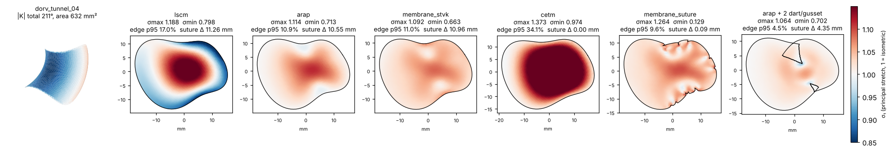

# Report 2: wider exploration of geometric methods (17 methods x 30 shapes), darting and developabilization

All figures referenced below are in `../docs/figures/`; the CSVs in `../results/` are from the same run
(`python scripts/run_benchmark.py` regenerates everything, including `report.pdf`).

## Second pass

Six more methods were added in `geometric/methods_extra.py` and the benchmark re-run (17 methods x 30
shapes, `results/` and `../docs/figures/` are from this run). Median over the 19 non-developable clinical
shapes:

| method | family | max stretch | min stretch | edge err p95 | boundary edge err max | suture mismatch | area err | shapes with folds |
|---|---|---|---|---|---|---|---|---|
| lscm (Baffle Planner) | conformal, area-scaled | 1.09 | 0.89 | 9.1 % | 8.6 % | 4.2 mm | 0 % | 0 |
| lscm_perimeter | conformal, perimeter-scaled | 1.16 | 0.96 | 14.9 % | 3.8 % | 0.4 mm | +14 % | 0 |
| asap | conformal | 1.08 | 0.89 | 8.8 % | 8.4 % | 4.4 mm | -1.6 % | 0 |
| arap | isometric | 1.06 | 0.87 | 5.6 % | 11.6 % | 4.0 mm | -0.2 % | 0 |
| arap_hybrid | isometric/conformal blend | 1.06 | 0.88 | 5.5 % | 10.0 % | 4.0 mm | -0.2 % | 0 |
| symmetric_dirichlet | isometric + fold barrier | 1.06 | 0.88 | 5.4 % | 11.1 % | 3.9 mm | +0.1 % | 0 |
| membrane_stvk | isometric (membrane) | 1.05 | 0.86 | 5.7 % | 12.1 % | 4.1 mm | -0.4 % | 0 |
| spring | edge springs | 1.06 | 0.80 | 5.3 % | 11.1 % | 3.6 mm | -0.2 % | 7 |
| membrane_suture | membrane, suture line held | 1.19 | 0.13 | 5.8 % | 0.2 % | 0.05 mm | 0 % | 13 |
| bff_lite | conformal, suture line held | 1.16 | 0.98 | 15.0 % | 0.0 % | 0.00 mm | +15 % | 0 |
| cetm | conformal, suture line held | 1.16 | 0.98 | 15.0 % | 0.0 % | 0.00 mm | +15 % | 0 |
| exp_map | geodesic polar | 1.65 | 0.47 | 13.8 % | 40.8 % | 6.8 mm | -5 % | 1 |
| harmonic (circle) | fixed boundary | 1.40 | 0.70 | 29.9 % | 0.0 % | 0.01 mm | +21 % | 0 |
| pca_projection | projection | 1.00 | 0.08 | 47.6 % | 57 % | 11.0 mm | -32 % | 8 |

What the second pass adds:

1. **The isometric family is one method.** ARAP, the ARAP/ASAP hybrid, symmetric Dirichlet and the
   StVK membrane agree to within 0.3 % on every metric; ARAP is the fastest and never folds, symmetric
   Dirichlet has a built-in fold barrier for meshes where ARAP might. There is nothing to gain from
   SLIM-type solvers at these mesh sizes (0.1 s per patch).
2. **Holding the suture line exactly is possible but has a price that must be shown.** CETM / BFF-lite
   (Springborn 2008; Sawhney & Crane 2017) give a template whose every boundary edge has exactly its 3D
   length with a conformal interior; on curved tunnels that means 15 % interior stretch and +15 % area.
   The suture-constrained membrane reaches the same boundary fit and instead *buckles* at the rim (13 of
   19 shapes fold) which is the physical "tissue bunching" a surgeon sees. The perimeter-scaled LSCM is
   the cheap middle ground (boundary error 3.8 % vs 8.6 %, suture mismatch 0.4 mm vs 4.2 mm) at +14 % area;
   it is a one-line change to the Baffle Planner's current rescale and worth exposing as an option.
3. **CETM and darts combine naturally**: on the darted mesh the cut edges are also held exactly, and CETM
   stays fold-free. With the current heuristic dart angles the interior still carries ~19 % error on the
   worst tunnels; solving for the cone angles (Soliman, Slepcev & Crane 2018) is the next step there.
4. **The exponential map is not a template method**; radial lengths are exact (it passes the Kizilski
   length/width check on 68 % of shapes, which says more about that check than about the method) while
   the rim is up to 40 % off.
5. **Developabilizing the baffle** (`developabilize.py`, PyTorch L-BFGS on the angle defects with the suture
   line fixed): for the Baffle-Planner-style baffles, moving the surface by at most 1.35 mm (RMS 0.2 mm)
   makes the baffle flattenable (|K| 158 -> 9 deg, ARAP edge error 4.4 -> 0.6 %, suture mismatch 0.6 ->
   0.3 mm on bp_tps_dorv_04). Swept tunnel baffles cannot be rescued this way (210 -> 124 deg at 0.9 mm);
   their boundary curve itself is incompatible with a developable surface. For a planner this is a
   useful mode: nudge the surgeon's baffle toward the nearest shape a flat patch can actually make.

Recommendation after both passes: ARAP as the default template (symmetric Dirichlet as the robust
fallback), `lscm_perimeter` or CETM offered as "suture-exact" variants with the interior stretch map shown,
darting when the suture mismatch exceeds a threshold, and developabilization offered at design time.

