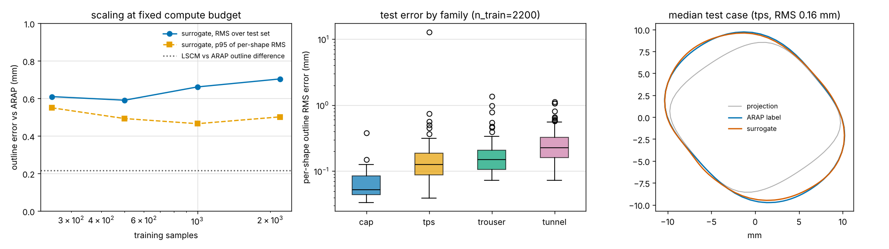

# Report 4: neural surrogate for patch flattening, feasibility study

Question: can a learned model trained on a large synthetic library flatten a patch faster
and/or more accurately than the geometric and physics solvers, and how many samples would it
take? This is a bounded study (one afternoon, CPU only) meant to decide whether to invest,
not a finished model.

## Setup

* Data: 2600 random baffles from the library generators (`physics_ml/synthetic_dataset.py`:
  45 % swept tunnels, 30 % Baffle-Planner TPS baffles with 0-3 surface points, 15 % trouser
  patches, 10 % caps), 400-2000 vertices each, labelled with the ARAP template, metrics and dart
  proposals. Generation 0.3 s per sample (2 cores, 6 min).
* Representation (`neural/data.py`): mesh-independent. Suture line resampled to 128 points by
  arclength with a canonical start point and direction; 256 surface points sampled by area with
  normals; everything in a canonical frame (boundary centroid, PCA axes, normal sign). Target:
  the ARAP outline rigidly aligned to the orthographic projection of the boundary, expressed as a
  residual over that projection (so a flat patch has target 0).
* Model (`neural/model.py`): circular 1D CNN on the boundary + PointNet on the surface samples,
  fused into a per-point decoder, 0.4 M parameters; auxiliary head for suture mismatch, total |K|
  and dart count. PyTorch, CPU.
* Protocol: 85/15 split (390 test shapes), training sets of 250 / 500 / 1000 / 2200 at a fixed
  compute budget of 24 000 sample-epochs per run (about 2 min each on 2 cores).
* Baselines on the same test set: orthographic projection (what a photo gives) and the LSCM
  outline versus the ARAP outline (how far the two best geometric methods are from each other,
  i.e. the accuracy a surrogate must reach to be as good as "a method").

## Results

| | outline error vs ARAP (mm) |
|---|---|
| orthographic projection (no model) | RMS 2.50, max 21.2 |
| LSCM vs ARAP (method-to-method difference) | RMS 0.22, max 2.4 |
| surrogate, n_train = 250 | RMS 0.61, p95 of per-shape RMS 0.55 |
| surrogate, n_train = 500 | RMS 0.59, p95 0.49 |
| surrogate, n_train = 1000 | RMS 0.66, p95 0.47 |
| surrogate, n_train = 2200 | RMS 0.70, p95 0.50 |

Per-shape RMS error of the n_train = 2200 model on the 390 test shapes: median **0.16 mm**, p75
0.26, p90 0.37, p95 0.50, p99 1.06, max 12.9 mm (one strongly bulged TPS baffle). By family:
caps 0.05 mm median, TPS baffles 0.13, trousers 0.15, tunnels 0.23. The target residual it has to
predict is 1.5 mm median (21 mm max), so the model removes about 90 % of the projection error.
Auxiliary suture-mismatch prediction: MAE 0.47 mm. Inference 4 ms per patch (CPU) vs 70-100 ms
for ARAP and 30-300 s for the physics inverse. Numbers in `results/neural_surrogate_feasibility.json`.

## Reading of the results

1. **Accuracy is not yet at the "as good as a method" level.** The median case (0.16 mm) is
   within the LSCM-vs-ARAP difference, but the tail (p95 0.5 mm, p99 1 mm) is 2-5x too large for
   a template that is cut and sutured, and a single outlier of 13 mm would be a clinical error.
   A surrogate for templates needs a bounded worst case, not a good average.
2. **No scaling with data between 250 and 2200 samples at this budget.** The curve is flat, so
   the model is training/capacity-limited, not data-limited; "how many samples" cannot be
   answered until training is 10-100x longer (GPU) and the loss and canonicalisation are fixed
   (the worst cases coincide with ambiguous start points / symmetric boundaries, which a
   cyclic-shift-invariant loss or Fourier descriptors remove).
3. **A supervised surrogate cannot be more accurate than its labels.** Trained on ARAP it can at
   best reproduce ARAP, which already runs in 0.1 s. "More accurate than physics" is only possible
   if the labels are better than the physics: measured outcomes from the physical library
   (Report 3, last section), or a higher-fidelity model distilled into the network. That is where
   a learned model has a real role.
4. **Speed matters where the solver is slow.** Flattening (level 1) is interactive already; the
   pressurised inverse (level 2, Report 3) takes minutes and is ill-posed without a strain
   criterion. A surrogate that predicts the least-strain template for given pressure and material
   (or a warm start for the adjoint solve, cutting minutes to seconds) is the valuable target, and
   the dataset generator already carries the pressure/material fields for it.

## Better options than a plain supervised outline regressor

* **Physics-informed (self-supervised) training**: train the network to minimise the ARAP or
  membrane energy of its own output directly (the energies are differentiable in PyTorch/Warp),
  no labels needed, and the output can always be polished by 1-2 local/global iterations that
  guarantee a valid template (amortised optimisation). This removes the label ceiling and the
  outlier problem at once.
* **Mesh-aware networks** (DiffusionNet-style or a graph network on the triangle mesh) predicting
  per-vertex UV instead of a 128-point outline, for arbitrary triangulations and interior strain
  maps; more expensive to train, no need for a canonical frame beyond centring.
* **Inverse-problem surrogate**: input (target 3D baffle, pressure, material) -> unloaded template,
  labels from the adjoint inverse with the strain criterion (Report 3); the model learns the
  design rule, and its output seeds the adjoint solve for the final answer.
* **Uncertainty**: an ensemble of 5 small models gives a per-point spread that can be drawn on the
  template, which none of the solvers provide on their own.

## Recommendation

Do not pursue a learned replacement for level-1 flattening; ARAP is fast, exact and benchmarked.
Pursue the learned model where the solver is slow or the labels can be better than the model:
(a) physics-informed amortisation of the pressurised inverse with Warp labels, (b) later, training
on measurements from the physical validation library. First engineering steps if continued:
shift-invariant loss, GPU training of the existing model on 10-20 k samples for a proper
scaling curve, and ensembles for uncertainty. Estimated data need for a template-grade
surrogate of the inverse: 10^4-10^5 samples, which the generator produces in hours on one GPU.
